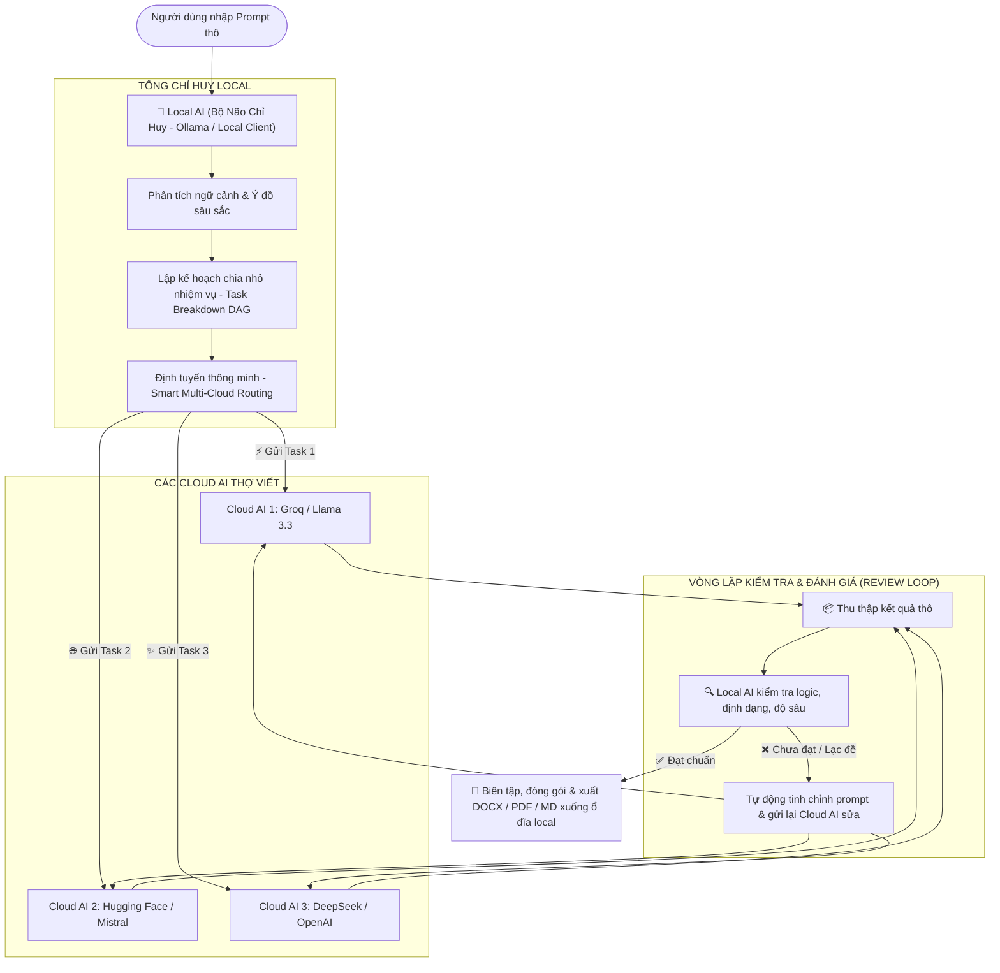
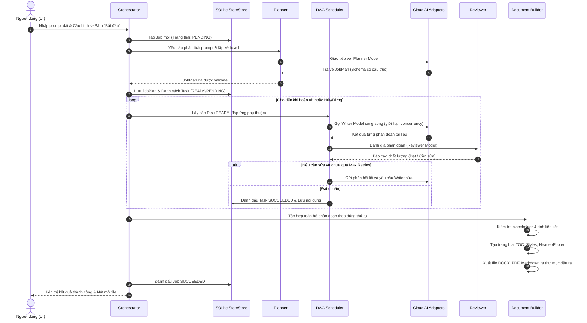

# KIẾN TRÚC HỆ THỐNG: LOCAL COMMAND BOT
## Multi-Cloud AI Document Orchestrator

---

## 1. TỔNG QUAN HỆ THỐNG

**Local Command Bot** là ứng dụng desktop chạy trực tiếp trên Windows (On-premise / Local client), cho phép người dùng tự động hóa quy trình phân tích yêu cầu nghiệp vụ phức tạp, chia nhỏ thành các nhiệm vụ phụ thuộc (DAG), phân bổ tác vụ cho nhiều nhà cung cấp Cloud AI (OpenAI, Anthropic, Google Gemini), kiểm soát chất lượng qua vòng lặp Reviewer-Writer, và tổng hợp thành tài liệu hoàn chỉnh (DOCX, PDF, Markdown).

Ứng dụng đáp ứng các tiêu chuẩn khắt khe về:
- **Độ tin cậy & Phục hồi sự cố**: Lưu trạng thái từng bước vào SQLite, khôi phục nguyên vẹn sau khi tắt ứng dụng hoặc mất điện.
- **Bảo mật & Quyền riêng tư**: API key lưu qua Windows Credential Manager (keyring), tuyệt đối không ghi log key, không path traversal, hỗ trợ chế độ Dry Run.
- **Tiêu chuẩn tài liệu chuyên ngành**: Đặc biệt tối ưu cho tài liệu Dược phẩm, SOP GMP theo quy định Việt Nam (ghi rõ trạng thái DRAFT, không tự bịa văn bản pháp quy, trích dẫn minh bạch nguồn).

---

## 2. KIẾN TRÚC PHÂN TẦNG (LAYERED ARCHITECTURE)

---

## 3. CÁC MODULE CHÍNH

### 3.1. Core Orchestration Engine (`app/core/`)
- **`models.py`**: Định nghĩa toàn bộ schema dữ liệu bằng Pydantic v2:
  - `Job`: Thực thể công việc tổng quát, chứa `job_id`, trạng thái (`PENDING`, `PLANNING`, `RUNNING`, `PAUSED`, `SUCCEEDED`, `FAILED`, `CANCELLED`), ngân sách, thời gian, cài đặt.
  - `Task`: Đơn vị thực thi độc lập/phụ thuộc, chứa `task_id`, `dependencies`, `role` (PLANNER, RESEARCHER, WRITER, REVIEWER, AUDITOR), `provider`, `model`, `status` (`PENDING`, `READY`, `RUNNING`, `SUCCEEDED`, `FAILED`, `RETRYING`, `CANCELLED`), `attempt_count`, `cost`.
  - `JobPlan`: Kế hoạch chi tiết sau khi Planner phân tích prompt người dùng.
  - `ReviewResult`: Kết luận rà soát của Reviewer (đạt/không đạt, danh sách lỗi, mức độ, yêu cầu sửa).
- **`state_store.py`**: Quản lý cơ sở dữ liệu SQLite:
  - Bảng `jobs`, `tasks`, `job_logs`, `source_references`.
  - Hỗ trợ atomic transactions, write-ahead logging (WAL mode).
  - Cho phép khôi phục nguyên vẹn trạng thái khi ứng dụng khởi động lại.
- **`scheduler.py`**:
  - Xây dựng đồ thị có hướng không chu trình (DAG).
  - Giải quyết thứ tự thực thi topo (topological sort).
  - Quản lý `asyncio.Semaphore` để giới hạn số tác vụ đồng thời (concurrency control).
  - Tính toán các task đã sẵn sàng (`READY`) khi toàn bộ dependencies đã `SUCCEEDED`.
- **`orchestrator.py`**:
  - Vòng lặp điều phối chính: lập kế hoạch -> thực thi task -> kiểm tra chất lượng -> lặp sửa (nếu cần) -> tổng hợp tài liệu.
  - Điều khiển: Start, Pause, Resume, Cancel.
  - Kiểm tra trần chi phí (Budget Cap) và dừng an toàn khi vượt ngưỡng.

### 3.2. Provider Adapters (`app/providers/`)
Interface thống nhất `BaseProviderAdapter`:
- `validate_config()`: Kiểm tra API key và endpoint.
- `list_models()`: Danh sách các model chính thức được hỗ trợ.
- `generate(prompt, system_prompt, temperature, max_tokens)`: Sinh văn bản.
- `generate_structured(prompt, schema)`: Trả về kết quả JSON khớp với Pydantic schema.
- `health_check()`: Kiểm tra kết nối nhanh mà không tốn nhiều token.
- `normalize_usage(response)`: Chuẩn hóa token usage và ước tính chi phí theo bảng giá hiện hành.
- `normalize_error(exception)`: Phân loại lỗi mạng, lỗi xác thực (401/403), lỗi quota (429/insufficient_quota), lỗi timeout.

Các Adapter cụ thể:
1. **`OpenAIAdapter`**: Sử dụng REST API `/v1/chat/completions`, hỗ trợ JSON response format.
2. **`AnthropicAdapter`**: Sử dụng REST API `/v1/messages` (Claude 3.5 Sonnet / Haiku).
3. **`GeminiAdapter`**: Sử dụng REST API `https://generativelanguage.googleapis.com/v1beta/models/{model}:generateContent`.
4. **`MockAdapter`**: Bộ giả lập deterministic dành riêng cho Unit Test, tích hợp kiểm thử ngoại lệ mạng, quota, và chế độ Dry Run.

### 3.3. Research & Documentation Engine
- **`app/research/researcher.py`**:
  - Tra cứu tài liệu, quy chuẩn Việt Nam (Dược điển VN, Thông tư Bộ Y tế, Nghị định, Hướng dẫn GMP-WHO/PIC/S).
  - Phân loại rõ: *Quy chuẩn bắt buộc*, *Hướng dẫn kỹ thuật*, *Khuyến nghị*.
  - Nguyên tắc chống ảo giác: Nếu không có URL hoặc số hiệu xác minh được, gắn cờ `Chưa xác minh — cần kiểm tra thủ công`.
- **`app/core/reviewer.py`**:
  - Rà soát tự động 8 khía cạnh: Đầy đủ, Logic, Nhất quán thuật ngữ, Trùng lặp, Mâu thuẫn, Trích dẫn nguồn, Dữ kiện chưa kiểm chứng, Tuân thủ prompt.
  - Tạo `ReviewCritique`: Trả về điểm, danh sách sai sót cụ thể. Nếu chưa đạt, kích hoạt Writer sửa lại (tối đa N vòng cấu hình).
- **`app/document/docx_builder.py`**:
  - Sử dụng `python-docx` tạo file `.docx` chuyên nghiệp.
  - Trang bìa trang trọng, bảng thông tin tài liệu, mã SOP, phiên bản, ngày ban hành, tình trạng DRAFT.
  - Mục lục tự động (TOC field code), Heading styles (Heading 1, 2, 3) đồng bộ font/màu sắc.
  - Bảng lịch sử sửa đổi (Revision History Table), bảng danh mục tài liệu tham chiếu.
  - Header & Footer với số trang tự động (`Page X of Y`).
- **`app/document/pdf_builder.py`**:
  - Sử dụng `reportlab` xuất bản PDF chất lượng cao, giữ nguyên định dạng, bảng biểu, header/footer.
- **`app/document/validators.py`**:
  - Quét phát hiện placeholder chưa xử lý (ví dụ `[Điền tên...]`, `<TBD>`, `[Số hiệu...]`).
  - Kiểm tra tính đầy đủ của các chương mục so với JobPlan.

### 3.4. Security & Configuration (`app/security/`, `app/config/`)
- **Keyring Manager**: Tương tác với Windows Credential Manager lưu trữ API key mã hóa.
- **Sanitizer**:
  - Kiểm tra chống tấn công Path Traversal đối với mọi đường dẫn thư mục/tệp.
  - Lọc bỏ API key khỏi mọi dòng log (Regex pattern masking).
  - Chống ghi đè tệp cũ: Tự động đánh số phiên bản `_v1`, `_v2` hoặc thêm timestamp nếu tệp đã tồn tại và chưa được cho phép ghi đè.

### 3.5. Desktop UI (`app/ui/`)
- Xây dựng trên nền **PySide6** (Qt 6.12).
- Luồng bất đồng bộ: `QThread` kết hợp `asyncio` loop, đảm bảo giao diện 60fps mượt mà, không bao giờ bị đơ (UI non-blocking).
- Theme Dark Mode hiện đại, bảng màu trực quan (Success: Emerald Green, Running: Cyan/Blue, Retrying: Amber, Failed: Rose Red).
- Các thành phần:
  - Input Panel: Textarea đa dòng cho prompt dài, chọn Output types (DOCX, PDF, MD), chọn Provider/Model cho từng vai trò.
  - Budget & Settings Panel: Concurrency limit, Max retries, Timeout, Budget limit ($).
  - DAG Progress Table: Hiển thị danh sách task thời gian thực, tiến độ, thời gian chạy, số lần retry.
  - Live Console Log Viewer: Hiển thị log chi tiết thời gian thực.
  - Execution Controls: Nút Start, Pause, Resume, Cancel, Nút Dry-Run.
  - Output Action Panel: Hiển thị link file, nút "Mở thư mục", "Mở tài liệu".

---

## 4. QUY TRÌNH THỰC THI (END-TO-END WORKFLOW)

---

## 5. RỦI RO KỸ THUẬT VÀ GIẢI PHÁP

| Rủi ro | Mức độ | Biện pháp giảm thiểu |
|---|:---:|---|
| **Rate Limit / Quota Exceeded từ Cloud AI** | Cao | Cơ chế Exponential Backoff với Jitter; kiểm tra header `Retry-After`; hiển thị cảnh báo rõ trên UI thay vì crash. |
| **Ứng dụng bị tắt đột ngột (Crash / Mất điện)** | Trung bình | Lưu trạng thái sau mỗi Task vào SQLite với WAL mode; khi mở lại ứng dụng hiển thị nút "Khôi phục phiên làm việc (Resume)". |
| **Ảo giác trích dẫn pháp lý trong SOP GMP** | Nghiêm trọng | Ép buộc đóng dấu "DRAFT — CHỜ RÀ SOÁT VÀ PHÊ DUYỆT"; Reviewer kiểm tra URL và số hiệu; ghi rõ "Chưa xác minh — cần kiểm tra thủ công". |
| **Treo giao diện (UI Freeze) khi gọi API mạng** | Cao | Tách biệt hoàn toàn luồng giao diện (PySide6 GUI Thread) và luồng xử lý (Background Worker / Asyncio Loop) thông qua Qt Signals/Slots. |
| **Lộ API Key trong nhật ký (Logs)** | Nghiêm trọng | Regex sanitizer tự động ẩn (mask) các chuỗi có định dạng `sk-...`, `AIzaSy...`, `ant-...` trong tất cả file log và console log. |
| **Xung đột ghi đè tệp đầu ra của người dùng** | Trung bình | Cơ chế kiểm tra tồn tại tệp: tự động sinh hậu tố phiên bản timestamp nếu chưa có xác nhận cho phép ghi đè. |
